<p align="center">
  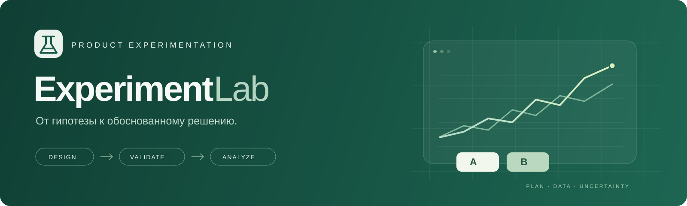
</p>

<p align="center">
  <strong>Рабочее пространство для планирования, проверки качества и анализа A/B-экспериментов.</strong>
</p>

<p align="center">
  <a href="https://github.com/66emil/experiementLab/actions/workflows/ci.yml"></a>
  
  
  
</p>

<p align="center">
  <a href="#возможности">Возможности</a> ·
  <a href="#скриншоты">Скриншоты</a> ·
  <a href="#следующие-этапы--ui-preview">UI Preview</a> ·
  <a href="#быстрый-старт">Быстрый старт</a> ·
  <a href="#архитектура">Архитектура</a> ·
  <a href="#документация">Документация</a>
</p>

---

ExperimentLab объединяет путь от формулировки гипотезы до оценки эффекта: сохранённый план, версии исходных данных, проверки качества и статистические расчёты с явными допущениями.

**Это работающий локальный MVP:** интерфейс связан с API и базой, загруженные CSV версионируются, а расчёты проверены на независимых численных примерах. Платформа показывает неопределённость и ограничения, не объявляя победителя автоматически.

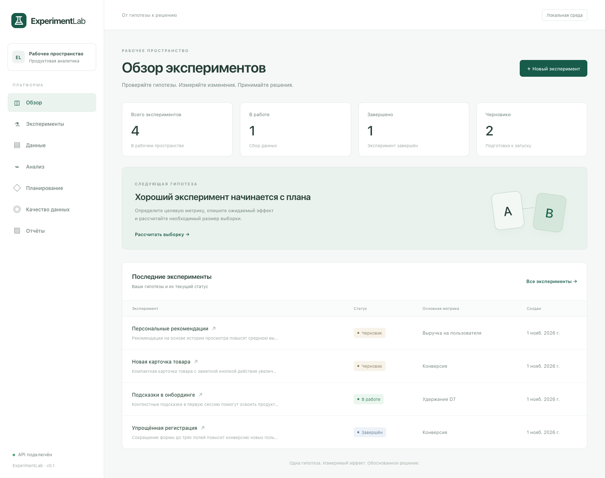

## Возможности

| Модуль | Что реализовано |
| --- | --- |
| **Experiment Designer** | Гипотеза, метрика, группы, baseline, ожидаемый эффект, α, мощность, рандомизация и планируемые даты |
| **Жизненный цикл** | `draft → running → completed`, фиксация плана после запуска, защита от конкурентных изменений |
| **Планирование выборки** | Расчёт для двух пропорций 50/50, предпросмотр и сохранение результата в эксперименте |
| **CSV & Data Versions** | Проверка строк, полные неизменяемые снимки, метаданные, SHA-256, история и скачивание оригиналов |
| **Experiment Health** | Пропуски, повторы пользователей, пересечение и размеры групп, SRM по сохранённому распределению |
| **Statistical Analysis** | Z-test двух пропорций, Welch t-test, абсолютный и относительный эффект, p-value, доверительный интервал и допущения |

Некорректные данные блокируют сравнение. Предупреждения показаны отдельно. Отсутствие SRM не означает хорошее качество данных, а малый p-value — готовое продуктовое решение.

Для этапов **5–9** подготовлена отдельная презентационная зона: история запусков, Analytics Dashboard, отчёт, Bootstrap и CUPED. Это **UI Preview с синтетическими примерами**; новые вычисления, хранение запусков и экспорт пока не реализованы. [Посмотреть будущие модули ↓](#следующие-этапы--ui-preview)

## Скриншоты

Снимки сделаны в **реальном приложении** на синтетических данных, через отдельную демонстрационную БД. Значения метрик, интервалы и результаты проверок рассчитаны статистическим пакетом. Нажмите на изображение, чтобы рассмотреть детали.

<table>
  <tr>
    <td width="50%" valign="top">
      <h3>План эксперимента</h3>
      <a href="docs/screenshots/designer.png">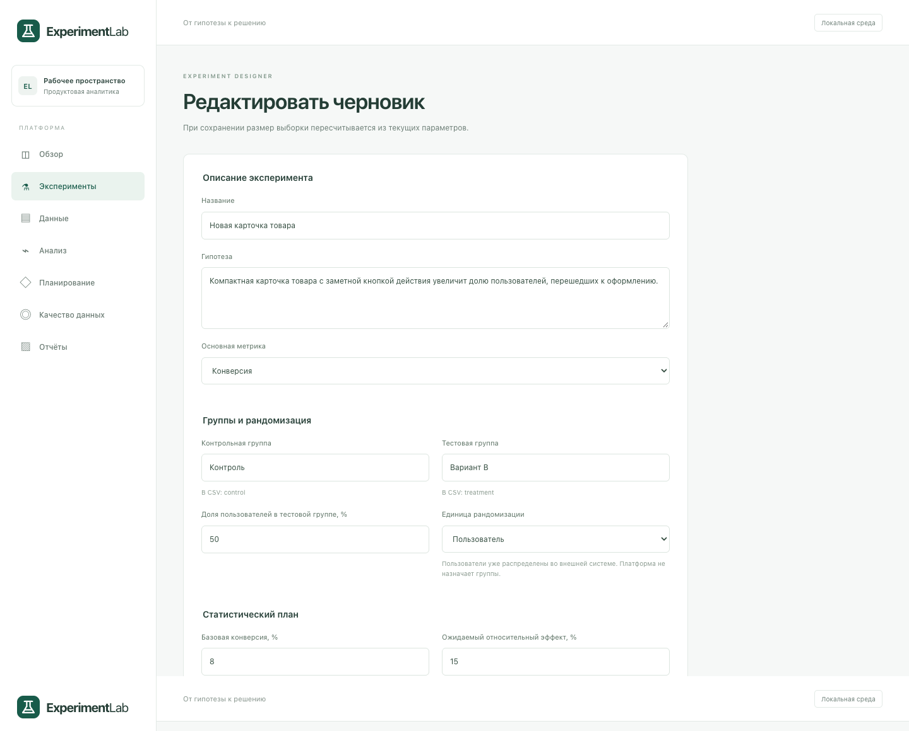</a>
      <p>Одна форма для создания и редактирования черновика.</p>
    </td>
    <td width="50%" valign="top">
      <h3>Эффект и неопределённость</h3>
      <a href="docs/screenshots/analysis.png">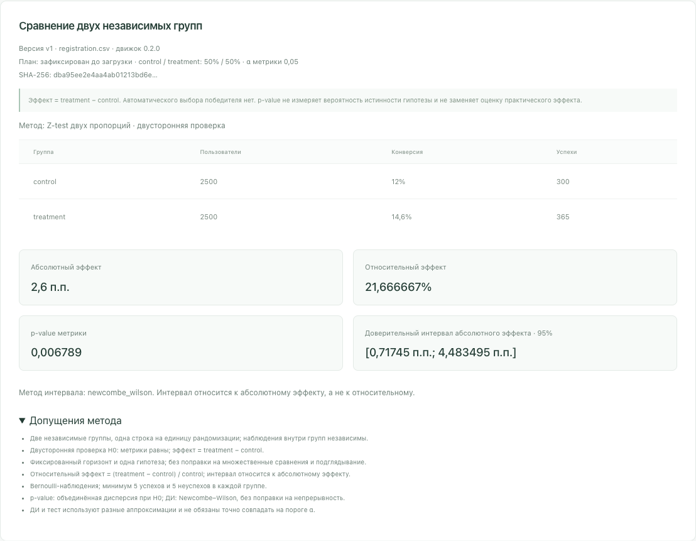</a>
      <p>Групповые оценки и интервал абсолютного эффекта без автоматического выбора победителя.</p>
    </td>
  </tr>
  <tr>
    <td width="50%" valign="top">
      <h3>Проверки качества</h3>
      <a href="docs/screenshots/health.png">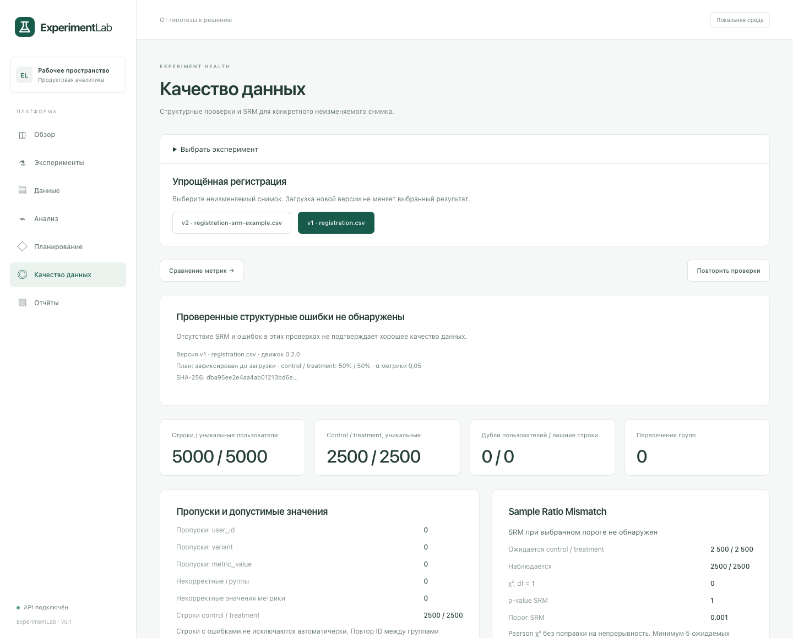</a>
      <p>Структурные проверки и SRM по плану выбранной версии.</p>
    </td>
    <td width="50%" valign="top">
      <h3>История данных</h3>
      <a href="docs/screenshots/datasets.png">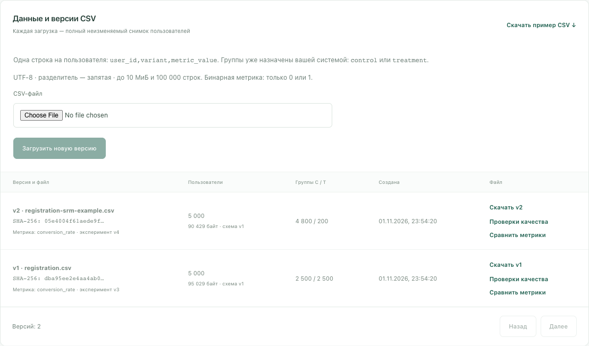</a>
      <p>Новые загрузки не переписывают предыдущие снимки.</p>
    </td>
  </tr>
</table>

<details>
  <summary><strong>Ещё: блокировка при SRM, Welch t-test и мобильный интерфейс</strong></summary>

  <h3>Проблемы распределения видны до анализа</h3>
  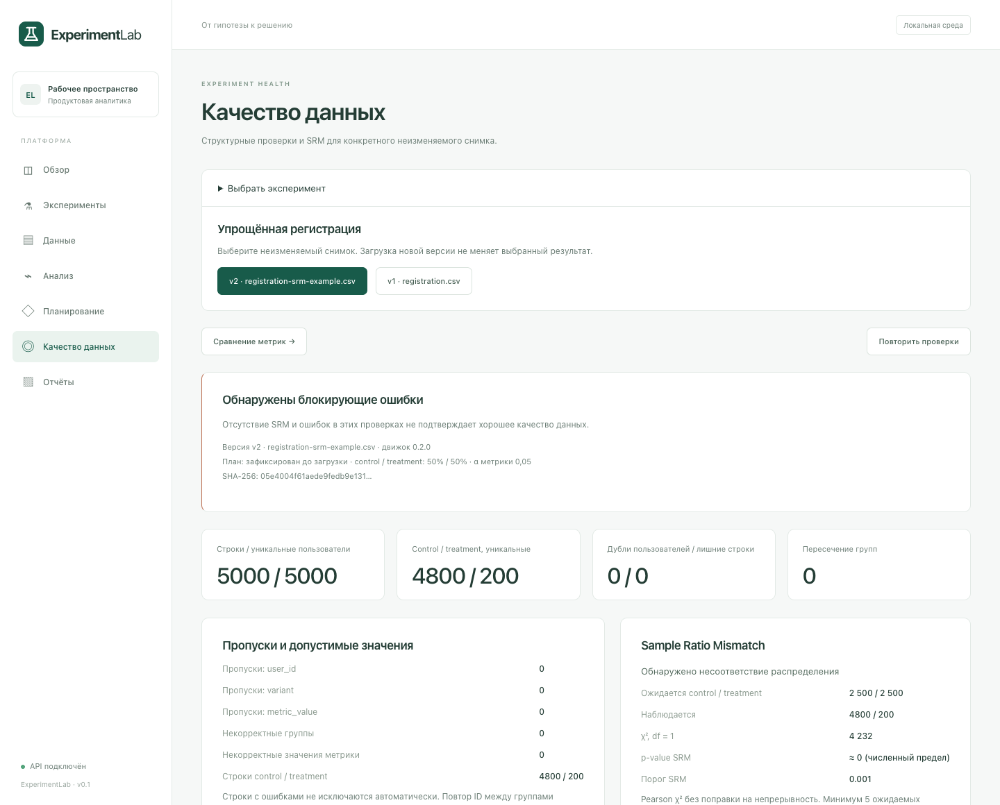

  <h3>Непрерывные метрики: Welch t-test</h3>
  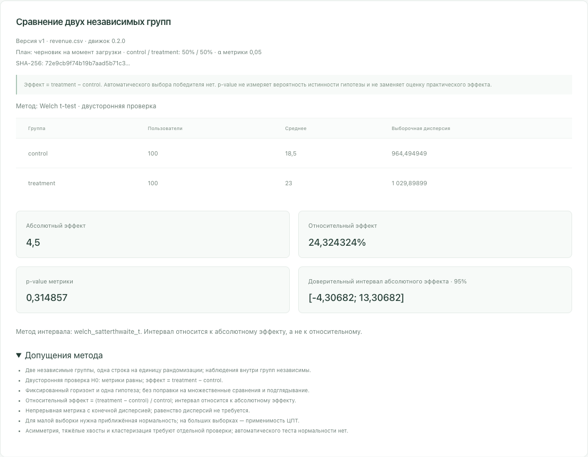

  <h3>Адаптивный интерфейс</h3>
  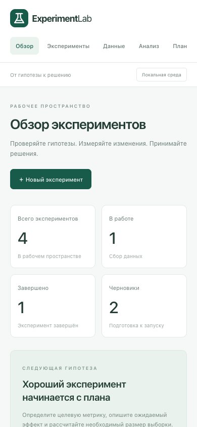

</details>

## Следующие этапы · UI Preview

Пять будущих модулей оформлены в одном визуальном стиле. Есть навигация, локальное переключение контекста и состояний, графики и мобильная адаптация. **Все значения в этой галерее заданы для макета.** Кнопки запуска и экспорта отключены; текущие API, база и статистические методы сохранены.

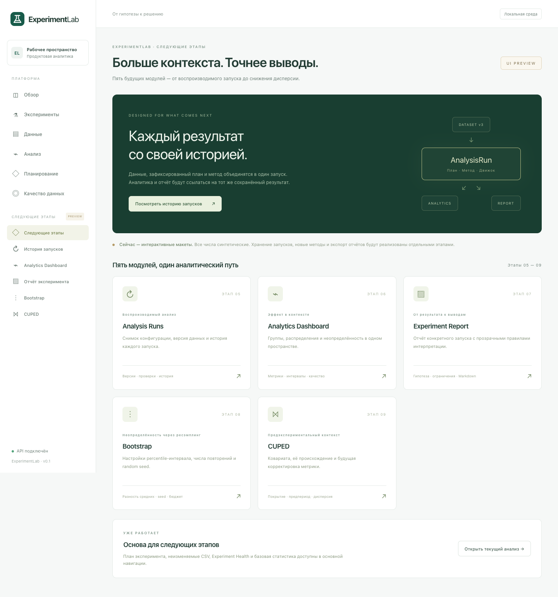

| Этап | Подготовленная оболочка | Будущая реализация |
| --- | --- | --- |
| **05 · AnalysisRun** | История, снимок плана/данных/метода, причины блокировки | Сущность, API, неизменяемое хранение результатов |
| **06 · Analytics Dashboard** | Метрики, ДИ, распределения, предупреждения, выбор контекста | Чтение сохранённых запусков и реальные графики |
| **07 · Experiment Report** | Документ, прозрачные правила вывода, образец Markdown | Воспроизводимое формирование и экспорт |
| **08 · Bootstrap** | Настройки percentile, B, seed, иллюстрация результата | Движок, бюджет ресурсов, воспроизводимость и эталоны |
| **09 · CUPED** | Контракт ковариаты, проверки, иллюстрации корректировки | Совместимый импорт, вычисление и проверка метода |

<table>
  <tr>
    <td width="50%" valign="top">
      <h3>05 · История запусков</h3>
      <a href="docs/screenshots/preview-runs.png">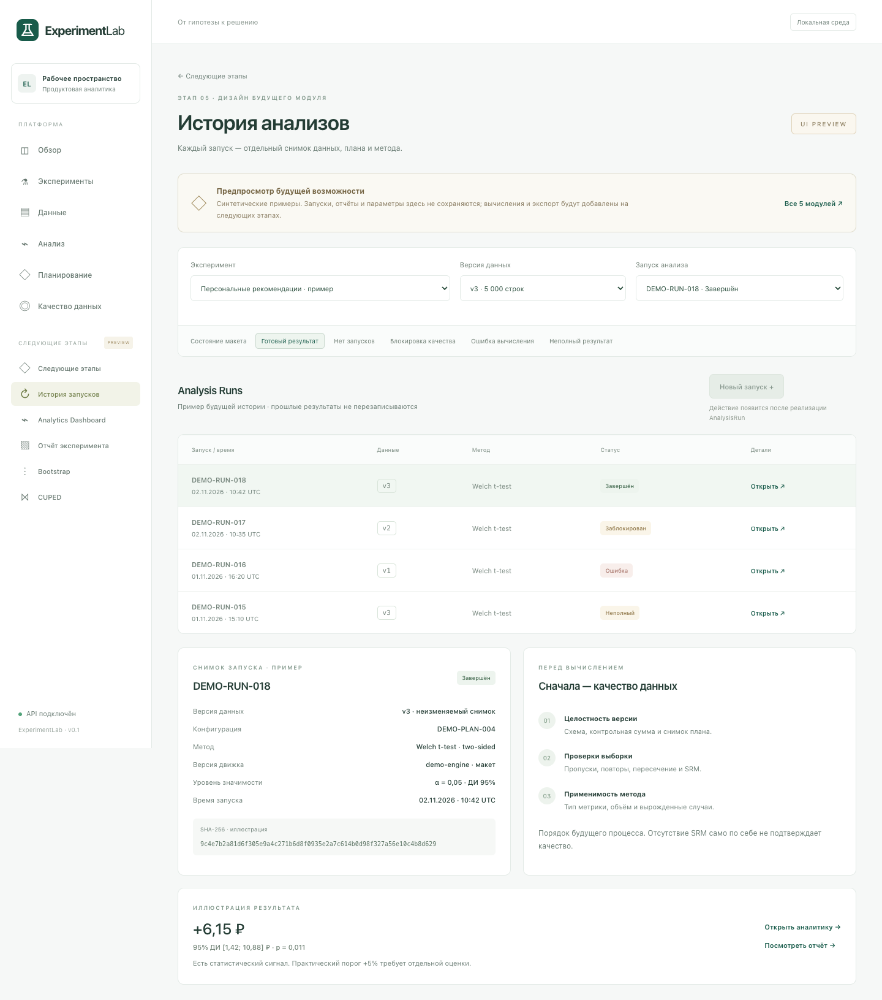</a>
      <p>Готовый, заблокированный, ошибочный и неполный запуск. Серверного хранения пока нет.</p>
    </td>
    <td width="50%" valign="top">
      <h3>06 · Аналитическое пространство</h3>
      <a href="docs/screenshots/preview-analytics.png">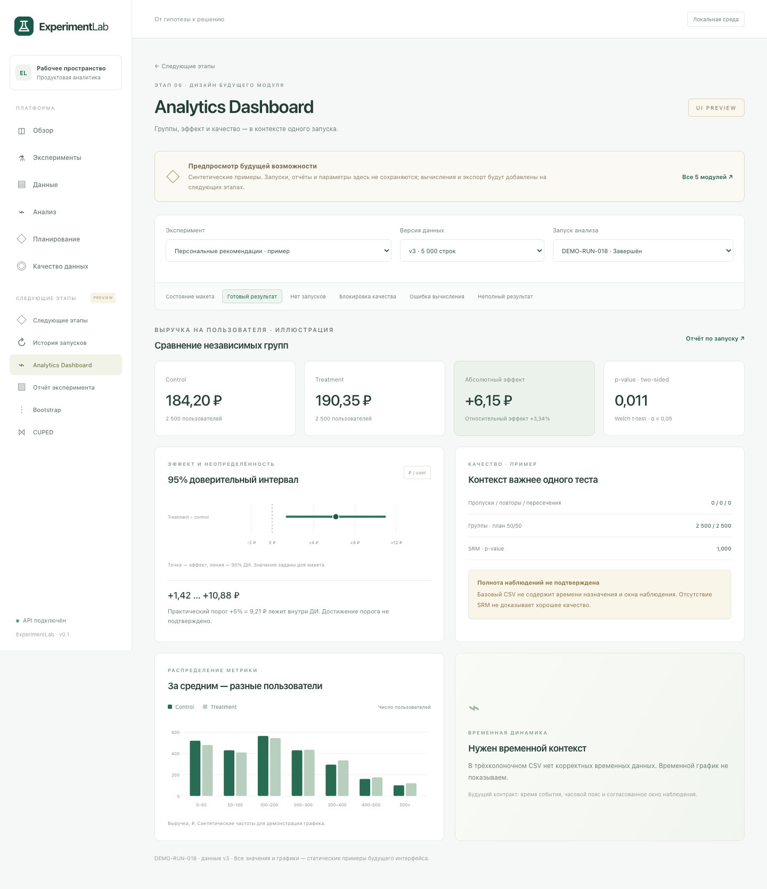</a>
      <p>Эффект и качество рядом. Временная динамика скрыта без корректных временных данных.</p>
    </td>
  </tr>
  <tr>
    <td width="50%" valign="top">
      <h3>07 · Отчёт конкретного запуска</h3>
      <a href="docs/screenshots/preview-report.png">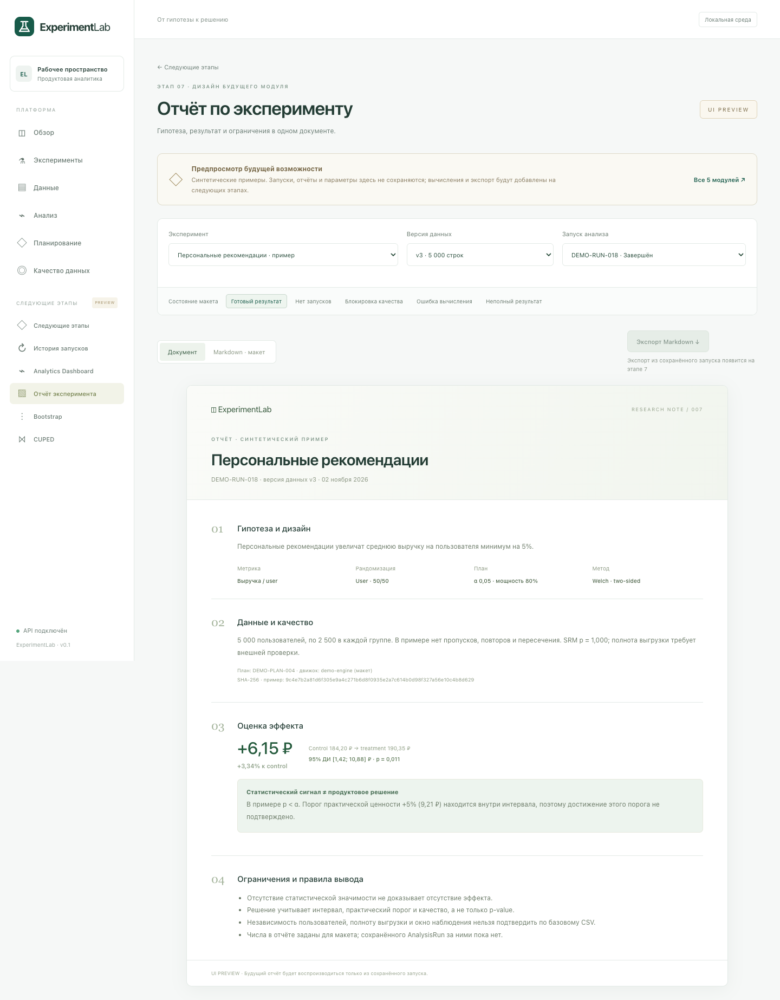</a>
      <p>Статистическая значимость и практическая ценность рассматриваются отдельно. Экспорт — следующий этап.</p>
    </td>
    <td width="50%" valign="top">
      <h3>08 · Bootstrap</h3>
      <a href="docs/screenshots/preview-bootstrap.png">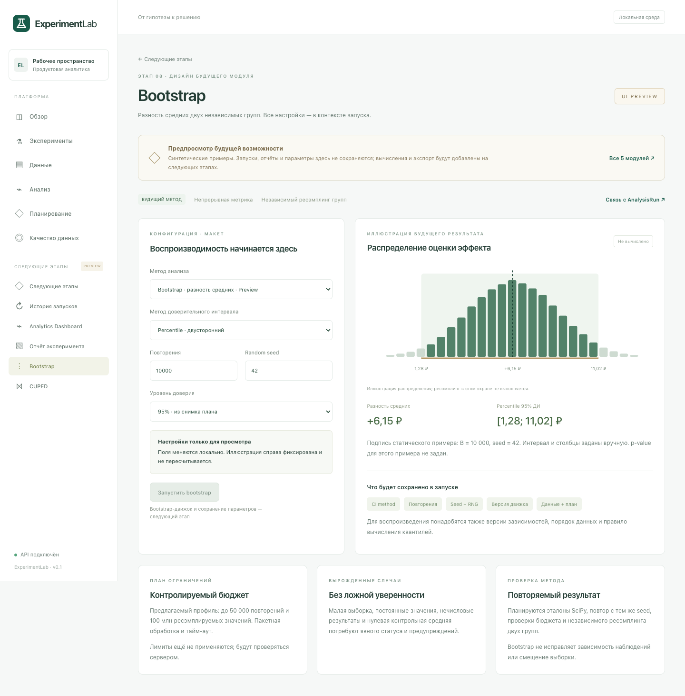</a>
      <p>Percentile, повторения и seed видны явно. Иллюстрация не пересчитывается при изменении полей.</p>
    </td>
  </tr>
</table>

<details>
  <summary><strong>09 · CUPED и мобильный Preview</strong></summary>

  <h3>Предэкспериментальная ковариата</h3>
  <a href="docs/screenshots/preview-cuped.png">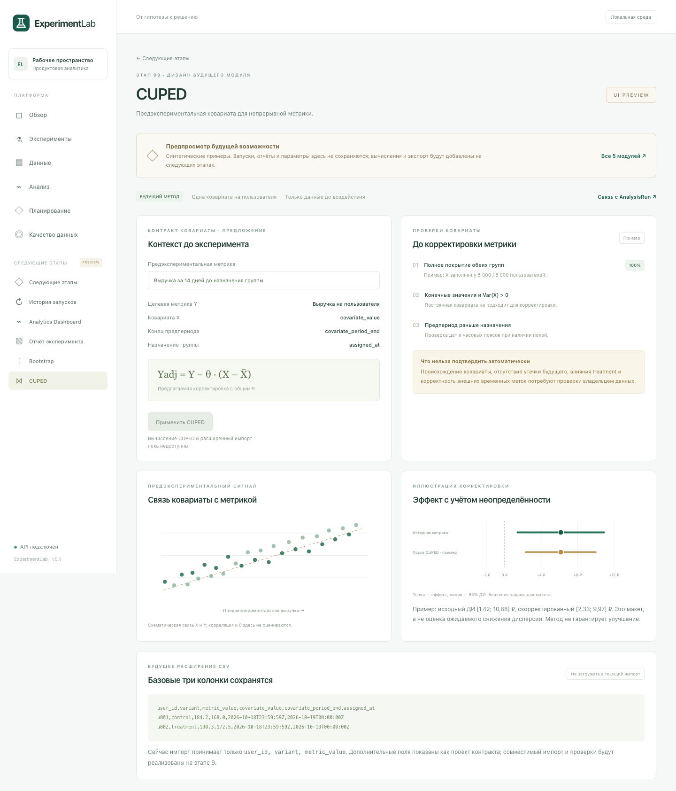</a>
  <p>Показаны предлагаемые дополнительные колонки CSV и условия, которые нельзя подтвердить автоматически. Текущий импорт остаётся трёхколоночным.</p>

  <h3>Адаптация к мобильному экрану</h3>
  <a href="docs/screenshots/preview-mobile.png">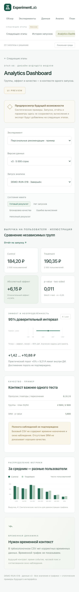</a>

</details>

Локально: **http://127.0.0.1:5173/preview**. Подробные границы оболочки и критерии следующих задач — в [плане этапов 5–9](docs/future-features.md).

## Быстрый старт

**Требования:** Node.js 22.12+, Python 3.12+ и [uv](https://docs.astral.sh/uv/getting-started/installation/). Для локального запуска Docker не нужен.

```sh
git clone https://github.com/66emil/experiementLab.git
cd experiementLab

npm ci
uv sync --frozen
npm run db:migrate
npm run db:seed
npm run dev
```

| Адрес | Назначение |
| --- | --- |
| **http://127.0.0.1:5173** | Интерфейс приложения |
| http://127.0.0.1:8000/docs | Интерактивная документация API |
| http://127.0.0.1:8000/ready | Готовность API и схемы БД |

`db:seed` добавляет три демонстрационных черновика; команда необязательная и повторяемая. База SQLite создаётся миграциями. Настройки по умолчанию уже работают; переопределения — через [.env.example](.env.example).

### Попробовать анализ на примере

1. Создайте эксперимент с метрикой «Конверсия» и группами 50/50.
2. Загрузите [registration.csv](examples/registration.csv): 2 500 пользователей в каждой группе, конверсии 12% и 14,6%.
3. Откройте «Проверки качества» и «Сравнить метрики» у сохранённой версии.

Черновик позволяет выполнить исследовательский расчёт с соответствующим предупреждением. Для фиксации плана до импорта заполните параметры и даты и пройдите жизненный цикл эксперимента. Подробнее и пример для Welch — в [каталоге демонстрационных данных](examples/README.md).

## Архитектура

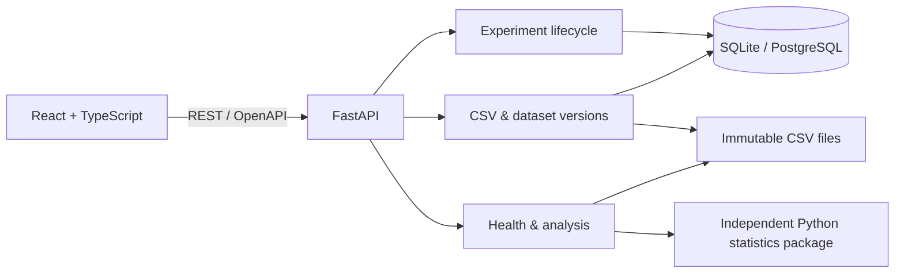

```text
apps/web/             интерфейс: app → pages → features → shared
backend/              API, бизнес-логика, хранение и миграции
packages/statistics/  независимые вычисления и численные эталоны
docs/                 архитектура, методы, ограничения и скриншоты
examples/             синтетические CSV для знакомства с платформой
```

Frontend не обращается к БД. Статистический пакет не зависит от FastAPI и хранения. TypeScript-типы генерируются из OpenAPI; схема данных меняется через Alembic. PostgreSQL можно подключить через [Compose](compose.yaml) — настройка описана в [руководстве разработчика](docs/development.md#postgresql).

## Проверка корректности

- **111 автоматических тестов**: API, жизненный цикл, конкурентные изменения, CSV, версии, Health и статистика.
- **Независимые эталоны**: опубликованные результаты R, отдельный запуск statsmodels и аналитические примеры χ².
- **Пограничные случаи**: недостаточная выборка, нулевые дисперсии, нулевая контрольная метрика и численные пределы.
- **GitHub Actions**: TypeScript, production-сборка, тесты, форматирование, миграции и актуальность API-контракта.
- **Браузерная проверка**: создание и редактирование, CSV, переключение версий, SRM-блокировка, оба метода и мобильная ширина.

```sh
npm run check
npm run format:check
uv run ruff check .
uv run ruff format --check .
```

Детали воспроизведения эталонов и интерпретации результатов — в [описании статистических методов](docs/analysis-methods.md).

## Документация

| Документ | Содержание |
| --- | --- |
| [Разработка и окружение](docs/development.md) | Запуск, переменные среды, команды, PostgreSQL и границы реализации |
| [Архитектура и API](docs/architecture.md) | Модули, зависимости, модель данных и маршруты |
| [Планирование выборки](docs/statistics.md) | Формула, параметры и условия применимости |
| [Health & SRM](docs/health.md) | Блокировки, предупреждения и ограничения проверки |
| [Статистические методы](docs/analysis-methods.md) | Z-test, Welch, интервалы и независимые эталоны |
| [OpenAPI](docs/openapi.json) | Машиночитаемый контракт |
| [План развития](docs/roadmap.md) | Реализованные этапы и следующие задачи |
| [Этапы 5–9 · UI Preview](docs/future-features.md) | Экраны, границы оболочки и критерии будущей реализации |
| [Участие в разработке](CONTRIBUTING.md) | Структура изменений и обязательные проверки |

## Текущий этап

Проект рассчитан на **локальную разработку и исследование**. Авторизация и рабочие пространства пока не реализованы. Планировщик запуска поддерживает бинарный сценарий 50/50 по пользователю; Welch и анализ неравных фактических размеров групп доступны отдельно для загруженных снимков.

Полноту выгрузки, окно наблюдения и зрелость retention по трём колонкам CSV подтвердить нельзя. Сохранение AnalysisRun, аналитика по истории, автоматические отчёты, bootstrap и CUPED представлены только макетами UI Preview. Их логика, последовательный анализ и поправки на множественные сравнения остаются в [roadmap](docs/roadmap.md).

---

<p align="center">Одна гипотеза · Измеримый эффект · Обоснованное решение</p>
