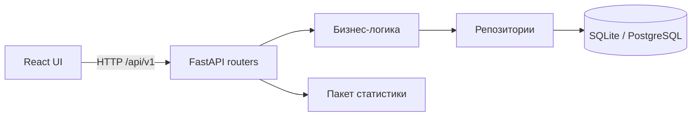

# Разбор требований и архитектурные решения

## Что задаёт ExperimentLab.md

Документ описывает аналитическую платформу с семью областями: обзор, дизайн эксперимента, управление данными, статистический анализ, контроль качества, визуализации и отчёты. Он требует разделения frontend, backend и статистики, поддержки демонстрационных и пользовательских данных, обработки ошибок и базовых страниц/API.

Это описание продукта, а не полная техническая спецификация. Из него нельзя однозначно определить формат наблюдений, правила рандомизации, длительность тестов, допустимые проверки и модель доступа.

## Принятые решения

| Область | Решение и причина |
| --- | --- |
| Репозиторий | Monorepo: изменения UI, контракта и вычислений проверяются вместе |
| Frontend | React, TypeScript strict, Vite, React Router; аналитическому приложению пока не требуется SSR |
| Серверное состояние | TanStack Query: кэш, отмена чтений, повтор запросов, инвалидация после создания |
| Backend | FastAPI, Pydantic, синхронные SQLAlchemy-сессии в синхронных обработчиках |
| Данные | SQLite для простого локального старта, PostgreSQL через тот же слой SQLAlchemy |
| Схема | Только миграции Alembic; startup API не создаёт таблицы и не добавляет демоданные |
| Статистика | Независимый Python-пакет без импортов FastAPI, SQLAlchemy и UI |
| Контракт | OpenAPI генерируется backend; UI использует генерируемые TypeScript-типы |
| Развёртывание | На данном этапе только локальная разработка; Docker Compose — опциональная БД |

Базовые API-паттерны сверены с [документацией FastAPI](https://fastapi.tiangolo.com/), требования Node — с [Vite](https://vite.dev/guide/), особенности внешних ключей SQLite — с [SQLAlchemy](https://docs.sqlalchemy.org/en/20/dialects/sqlite.html#foreign-key-support).

## Зависимости слоёв

Frontend не обращается к БД. Маршруты отвечают за HTTP и валидацию, сервисы — за сценарии и инварианты, репозитории — за запросы. Каталог метрик пока статический; таблица метрик потребуется при пользовательских определениях. Статистика получает обычные значения и возвращает результаты без побочных эффектов.

Модуль `datasets` содержит CSV-валидацию, версии и файловое хранилище. Модуль `analysis` читает конкретный снимок, проверяет целостность и метаданные, вызывает независимые Health/SRM и статистические методы. Страница `reports` пока обозначает будущую функциональность.

## Первая модель данных

`Experiment` хранит UUID, гипотезу, метрику, статус, группы и доли, α, ожидаемый относительный эффект, baseline, мощность, единицу рандомизации, плановые даты, размер выборки и фактические даты переходов. Новые эксперименты создаются как `draft` и `is_demo=false`.

При запуске сохраняется `locked_plan` с параметрами, методом, рассчитанной выборкой и версией плана. Все изменения выполняются с ожидаемой `version`. SQLAlchemy `version_id_col` защищает и от гонки между чтением и записью; устаревшая операция возвращает 409. Разрешены только draft → running → completed. Для текущего запуска нужен полный поддерживаемый план: бинарная метрика, 50/50, `user`, baseline, эффект и обе даты. Редактирование возможно только в draft.

`DatasetVersion` — самостоятельный полный снимок, связанный с экспериментом. Метаданные содержат номер версии, размер, SHA-256 исходных байтов, счётчики пользователей и групп, время, схему и снимок конфигурации. Номер версии уникален внутри эксперимента; вставка увеличивает счётчик и версию эксперимента в одной транзакции. Поэтому параллельный импорт/запуск/редактирование не может незаметно изменить контекст загрузки.

Исходные CSV хранятся вне БД под UUID-именами. Запись эксклюзивная, завершённый файл доступен только для чтения, API изменения/удаления версий отсутствует. При ошибке записи БД новый файл удаляется. Скачивание проверяет SHA-256. Аварийное завершение процесса между файловой записью и commit теоретически может оставить непривязанный файл; для нескольких инстансов потребуются объектное хранилище и процедура сверки. Полностью ошибочный CSV не сохраняется. После первой версии заблокирована смена метрики и единицы рандомизации.

CSV принимается потоково как `text/csv`; лимит проверяется по фактически полученным байтам, независимо от Content-Length. Разбор и операции БД выполняются в thread pool. Формат: UTF-8, запятая, ровно user_id/variant/metric_value; ID уникален внутри версии, варианты control/treatment. Данные не используются для назначения групп. Пользовательские файлы не привязываются к демо. Следующий шаг анализа — `AnalysisRun`, ссылающийся на конкретную версию данных и зафиксированный план.

Механизмы сверены с документацией [SQLAlchemy version counters](https://docs.sqlalchemy.org/en/21/orm/versioning.html), [Starlette request streaming](https://starlette.dev/requests/) и [Python CSV](https://docs.python.org/3/library/csv.html).

## HTTP API

| Метод | Путь | Назначение |
| --- | --- | --- |
| GET | `/health` | Процесс доступен |
| GET | `/ready` | База и таблица экспериментов доступны |
| GET | `/api/v1/metrics` | Каталог поддерживаемых метрик |
| GET | `/api/v1/experiments` | Список; `q`, `status`, `limit`, `offset` |
| GET | `/api/v1/experiments/summary` | Глобальные счётчики |
| POST | `/api/v1/experiments` | Создание черновика |
| GET | `/api/v1/experiments/{id}` | Чтение эксперимента |
| PUT | `/api/v1/experiments/{id}` | Полная конфигурация черновика и ожидаемая `version` |
| POST | `/api/v1/experiments/{id}/sample-size` | Расчёт и сохранение выборки; тело `version` |
| POST | `/api/v1/experiments/{id}/transition` | Переход; тело `status`, `version` |
| POST | `/api/v1/analysis/sample-size` | Планирование выборки для двух пропорций |
| GET | `/api/v1/datasets/limits` | Лимиты импорта |
| GET | `/api/v1/datasets/example` | Скачать пример CSV |
| POST | `/api/v1/experiments/{id}/datasets` | Тело — исходные CSV-байты, query `filename`, `version` эксперимента |
| GET | `/api/v1/experiments/{id}/datasets` | История версий с `limit`, `offset` |
| GET | `/api/v1/experiments/{id}/datasets/{dataset_id}` | Метаданные версии |
| GET | `/api/v1/experiments/{id}/datasets/{dataset_id}/download` | Проверенный исходный CSV |
| GET | `/api/v1/experiments/{id}/datasets/{dataset_id}/health` | Повторные проверки и SRM по сохранённому распределению |
| GET | `/api/v1/experiments/{id}/datasets/{dataset_id}/analysis` | Сравнение метрик после Health; без автоматического решения |

Оба evaluation API работают без изменения БД и возвращают SHA-256, версию движка и контекст плана. Используется `locked_plan` из снимка при загрузке, иначе тот же исходный черновик с предупреждением. Текущий изменяемый план эксперимента не подменяет контекст старой версии. Дубликаты и пропуски не отбрасываются для получения «чистого» p-value. Детали: [Health](health.md), [методы анализа](analysis-methods.md).

Формат прикладной ошибки: `{"error":{"code":"...","message":"...","details":[]}}`. Для CSV в details приходят `row`, `column`, `code`, `message`; это физические номера строк (заголовок — 1). Отчёт ограничен первыми 100 ошибками, общее число указывается в message. SQL-ошибки клиенту не передаются. Полные схемы: [openapi.json](openapi.json).

## Что уточнить перед следующими этапами

- Правила включения и окно наблюдения; CSV уже определён как одна строка на пользователя.
- Поддержка кластерной рандомизации и иной гранулярности данных.
- Одна тестовая группа или несколько? Нужны ли неравные доли и метрики отношений?
- Fixed horizon или последовательный анализ, правила остановки и поправки на множественные сравнения.
- Для CUPED — доступность и временная граница предэкспериментальной ковариаты.
- Часовой пояс событий, валюта, правила выбросов и зрелость retention-метрик.
- Рабочие пространства, роли, объёмы файлов, хранение и сроки удаления данных.

Эти вопросы не блокируют каркас, но определяют корректность будущего анализа.
